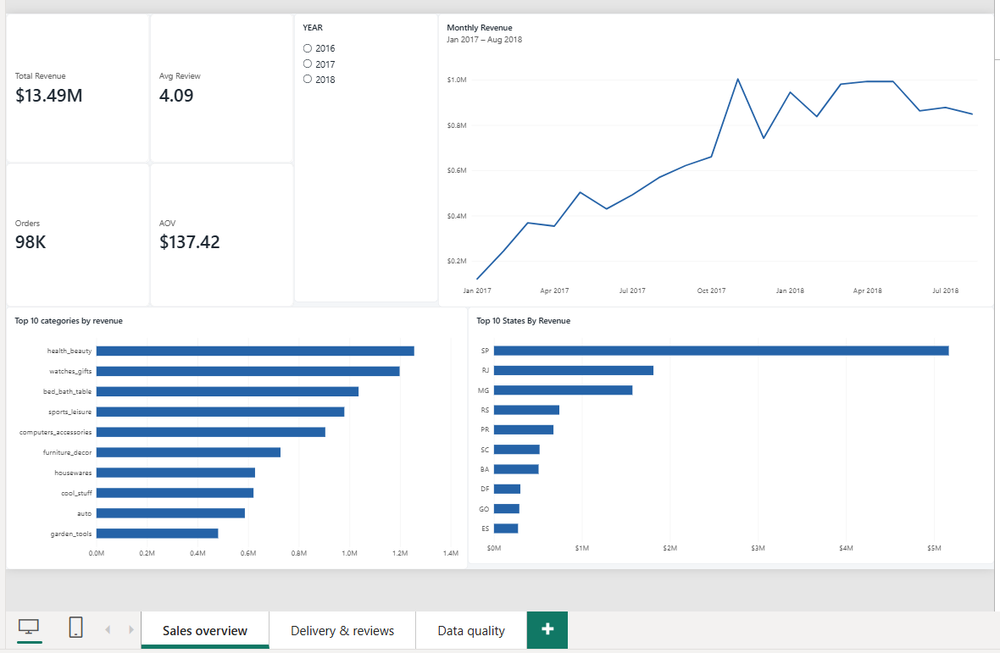
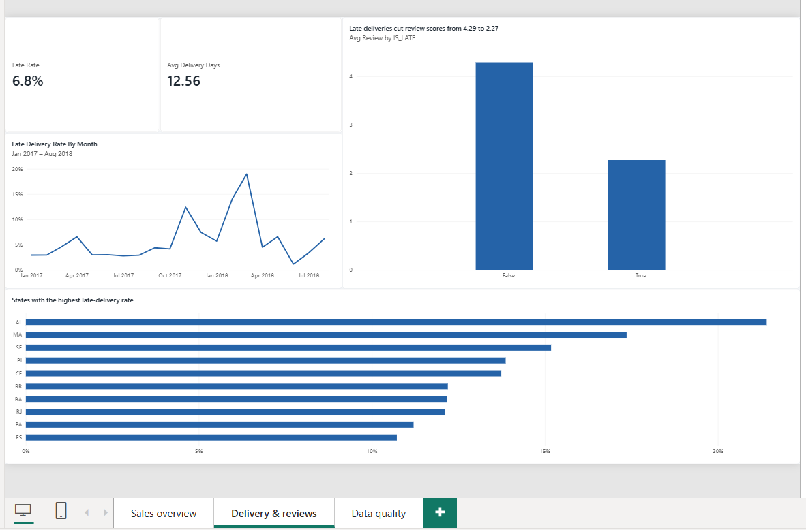
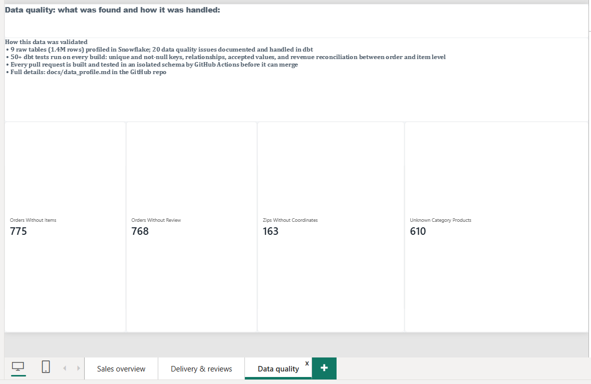

# Olist E-Commerce Analytics Platform

**Snowflake · dbt · Airflow · GitHub Actions · SQLFluff · Power BI**

An end-to-end analytics engineering project on about 100,000 real Brazilian
e-commerce orders (Olist, 2016–2018). Raw CSVs are loaded into Snowflake,
modelled with dbt into a tested and documented star schema, orchestrated daily
by Airflow, checked by CI on every pull request, and reported in Power BI
through a read-only role.

## Key findings

| Metric | Value |
|---|---:|
| Revenue (orders not canceled or unavailable) | **R$13.49M** |
| Revenue orders | **98,207** |
| Average order value | **R$137.42** |
| Average review score | **4.09 / 5** |
| Late-delivery rate | **6.8%** (6,534 of 96,470 delivered orders) |

1. **Late deliveries cut the average review score from 4.29 to 2.27.** Late
   orders score about two stars lower, which explains why 1-star reviews
   (11.5%) are far more common than 2-star reviews (3.2%).
2. **Late delivery is regional.** The worst states are in the north-east:
   Alagoas (AL) is late on about 21% of orders and Maranhão (MA) on about 17%,
   2.5–3× the national rate.
3. **Late deliveries spiked to about 19% in Feb–Mar 2018**, nearly three times
   the usual rate, before returning to normal.
4. **Revenue grew through 2017 and peaked in November 2017 (Black Friday)**,
   then held at about R$0.85–1.0M per month in 2018.
5. **São Paulo (SP) generates about 38% of revenue.** Top categories are
   health & beauty, watches & gifts, and bed, bath & table.
6. **Almost every customer buys once:** 96,096 people placed 99,441 orders.

## Architecture

```
Kaggle CSVs ──PUT──▶ Snowflake stage ──COPY INTO──▶ RAW (9 tables, all VARCHAR)
                                                     │
                                       dbt (21 models, 87 tests)
                                                     ▼
              STAGING (9 views) ──▶ INTERMEDIATE (5 views) ──▶ MARTS (7 tables)
                                                     │              │
                                     SNAPSHOTS (SCD2 products)      ▼
                                                     Power BI (REPORTER role, read-only)

Airflow (daily): load_raw → dbt deps → source freshness → dbt build → dbt docs
GitHub Actions (every PR): SQLFluff lint → dbt build in a throwaway schema → drop schema
```

| Snowflake schema | Built by | Contents |
|---|---|---|
| RAW | `snowflake/01_load_raw.sql`, `ingestion/load_raw.py` | 9 source tables as text, plus `_source_file` and `_loaded_at` |
| STAGING | dbt views | Rename, cast, deduplicate; one model per source |
| INTERMEDIATE | dbt views | One row per order per topic: items, payments, latest review, delivery metrics, customer order sequence |
| MARTS | dbt tables | `fct_orders`, `fct_order_items` (incremental), `dim_customers`, `dim_products`, `dim_sellers`, `dim_geography`, `dim_date` |
| SNAPSHOTS | dbt snapshot | `snap_products`: SCD Type 2 history of product attributes |

## Data model

| Model | Grain | Notes |
|---|---|---|
| `fct_orders` | One row per order (99,441) | Starts from orders and LEFT JOINs pre-aggregated inputs, so no order is lost and no join multiplies rows |
| `fct_order_items` | One row per order item (112,650) | Incremental: merge on `order_item_key` with a 3-day lookback |
| `dim_customers` | One row per person (96,096) | Uses `customer_unique_id`; Olist's `customer_id` is created per order |
| `dim_products` | One row per product (32,951) | English category names; a dbt seed fills two missing translations |
| `dim_sellers` | One row per seller (3,095) | |
| `dim_geography` | One row per zip prefix (19,173) | Includes every zip used by a customer or seller; 163 have no coordinates |
| `dim_date` | One row per day (1,096) | 2016-01-01 to 2018-12-31 |

**Metric definitions** (also in the dbt YAML, so people and tools read the same rule):

- **Revenue** = sum of item price for orders not canceled or unavailable. Freight and payments are separate.
- **Average order value** = revenue ÷ revenue orders that have at least one item.
- **Late delivery** = delivered date after the estimated delivery date. Unknown (null) unless the order is delivered and both dates exist.
- **Repeat customer** = a `customer_unique_id` with 2 or more delivered orders.

## Data quality

Profiling the raw data before modelling found 20 issues, each documented with
its count, impact, fix and guarding test in [`docs/data_profile.md`](docs/data_profile.md).
Examples:

- **`review_id` is not unique:** 814 rows reuse an id across orders, and 551 orders have more than one review. Staging uses (review_id, order_id) as the grain, and only the latest review per order reaches `fct_orders`.
- **Geolocation has about 53 rows per zip prefix** (1,000,163 rows, 26% exact duplicates, 42 points outside Brazil). Staging collapses it to one row per zip; joining the raw table would have multiplied every customer row.
- **775 orders have no items** (mostly unavailable or canceled). They are kept, with revenue 0, so cancellation analysis is not undercounted.
- **254 orders (0.26%) are paid more than items + freight**, most likely from instalment interest. A custom test warns above 0 and fails only above 1,000.

The Power BI data quality page shows these counts from the marts, and they
match the profiling numbers.

## Testing and CI

- **87 dbt tests:** unique and not-null keys, relationships between every fact and dimension, accepted values, value ranges (`dbt_expectations`), row-count equality, and three custom tests (delivery never before purchase, payment reconciliation, and revenue reconciling between `fct_orders`, `fct_order_items` and the source).
- **GitHub Actions** builds and tests the whole project for every pull request in an isolated schema (`CI_PR_<number>_*`), then drops it. Branch protection blocks merging when CI fails.
- **SQLFluff** enforces one SQL style across all models.

## Orchestration

`airflow/dags/olist_pipeline.py` runs daily in Docker (Airflow 3, `docker compose up -d --build`):
`load_raw → dbt_deps → dbt_source_freshness → dbt_build → dbt_docs_generate`.
Each task retries twice. The loader is idempotent: rerunning it skips files
Snowflake has already loaded, so retries and reruns never duplicate rows.

## Security and cost

- **Roles:** `TRANSFORMER` loads and builds; `REPORTER` reads `MARTS` only, through future grants, so new dbt tables are readable without extra grants.
- **Service user:** dbt, Airflow and CI connect as `DBT_SVC` (`TYPE = SERVICE`) with RSA key-pair authentication. No passwords are stored anywhere.
- **Tested, not assumed:** a check showed `REPORTER` could still read `RAW` because Snowflake's default secondary roles combine all of a user's roles in a session. Default secondary roles were turned off and the restriction re-tested.
- **Cost:** XS warehouse with 60-second auto-suspend and a resource monitor that suspends the warehouse before trial credits run out.

## Dashboard

`dashboard/olist_dashboard.pbix` (Import mode, connected with the `REPORTER` role).

| Sales overview | Delivery & reviews | Data quality |
|---|---|---|
|  |  |  |

## How to run

**Prerequisites:** Python 3.10–3.12, Git, Docker Desktop (for Airflow), a Snowflake account, and the
[Olist dataset](https://www.kaggle.com/datasets/olistbr/brazilian-ecommerce) unzipped into `data/`.

```bash
python -m venv .venv && source .venv/Scripts/activate   # macOS/Linux: .venv/bin/activate
pip install -r requirements.txt
cp .env.example .env                                    # fill in account, key path, key folder
```

1. **Create the service user key** (outside the repo):
   ```bash
   mkdir -p ~/.snowflake && cd ~/.snowflake
   openssl genrsa 2048 | openssl pkcs8 -topk8 -inform PEM -out rsa_key.p8 -nocrypt
   openssl rsa -in rsa_key.p8 -pubout -out rsa_key.pub
   grep -v "PUBLIC KEY" rsa_key.pub | tr -d '\n'; echo   # one-line public key for Snowflake
   ```
2. **Snowflake:** run `snowflake/00_setup.sql` in Snowsight as an admin, with your public key in the `ALTER USER` line.
3. **Load RAW:** `python ingestion/load_raw.py`
4. **Build:**
   ```bash
   cd dbt
   export $(grep -v '^#' ../.env | tr -d '\r' | xargs) && export DBT_PROFILES_DIR="$PWD"
   dbt deps && dbt build                 # dev schemas (DBT_DEV_*)
   dbt build --target prod               # STAGING, INTERMEDIATE, MARTS, SNAPSHOTS
   ```
5. **Airflow:** `docker compose up -d --build`, then open http://localhost:8080 and trigger `olist_pipeline`.
6. **CI:** add the `SNOWFLAKE_ACCOUNT` and `SNOWFLAKE_PRIVATE_KEY` repository secrets.

## Repo layout

```
snowflake/       00_setup.sql (roles, warehouse, service user), 01_load_raw.sql, 02_profile_raw.sql
ingestion/       load_raw.py: PUT + COPY INTO in one idempotent command
dbt/             models (staging, intermediate, marts), seeds, snapshots, tests, macros
airflow/         Dockerfile and the daily DAG
.github/         CI workflow
dashboard/       Power BI file and screenshots
docs/            data_profile.md
AI_LOG.md        how AI was used, and how its output was checked
```

## Limitations and next steps

- Olist is a one-time export, so source freshness warns after 7 days. In production the loader would land new files daily.
- Next dashboard pages: seller performance (minimum 30 orders per seller) and customer cohorts.
- Possible extensions: Snowflake Dynamic Tables, Terraform for the Snowflake setup, and alerting from Airflow to Slack.

## Built AI-first

Built with Claude as a pair programmer. Every AI-generated model was validated
with dbt tests and row-count checks before it was committed, and every mistake
it made is logged with how it was caught. See [AI_LOG.md](AI_LOG.md).
